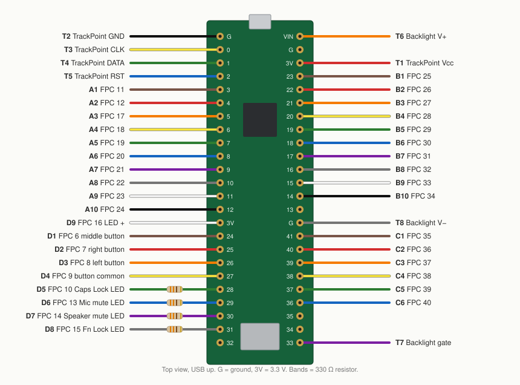

# T14 Gen 1 keyboard → USB

A ThinkPad T14 Gen 1 keyboard as a USB keyboard and mouse, driven by a Teensy 4.1. Keys, Fn layer, TrackPoint, mouse buttons, indicator LEDs and backlight.

All 84 keys are [verified on hardware](docs/verified-keymap.md). The TrackPoint, buttons, LEDs and backlight are not yet tested on hardware.

## Parts

- Teensy 4.1 and a micro-USB data cable
- 40-pin 0.5 mm FPC breakout and 12-pin 1.0 mm FPC breakout
- 4 × 330 Ω resistors
- Hookup wire, multimeter

## 1. Wire

Unplug USB while wiring. The Teensy is 3.3 V only; T6 is the only wire on 5 V (VIN).



- D5–D8 each get a 330 Ω resistor in line.
- Leave FPC 1–5 and the 12-pin ribbon’s M, R, L contacts unconnected.

<details>
<summary>Wire list</summary>

<!-- wiring-tables:start -->
| Wire | Color | FPC | Teensy | Function |
| :--- | :--- | ---: | :--- | :--- |
| A1 |  | 11 | pin 3 | Key column C8 |
| A2 |  | 12 | pin 4 | Key row R16 |
| A3 |  | 17 | pin 5 | Key row R12 |
| A4 |  | 18 | pin 6 | Key row R8 |
| A5 |  | 19 | pin 7 | Key row R9 |
| A6 |  | 20 | pin 8 | Key row R10 |
| A7 |  | 21 | pin 9 | Key row R11 |
| A8 |  | 22 | pin 10 | Key row R15 |
| A9 |  | 23 | pin 11 | Key row R14 |
| A10 |  | 24 | pin 12 | Key row R5 |
| B1 |  | 25 | pin 23 | Key row R7 |
| B2 |  | 26 | pin 22 | Key row R6 |
| B3 |  | 27 | pin 21 | Key row R3 |
| B4 |  | 28 | pin 20 | Key row R1 |
| B5 |  | 29 | pin 19 | Key column C0 |
| B6 |  | 30 | pin 18 | Key row R2 |
| B7 |  | 31 | pin 17 | Key row R4 |
| B8 |  | 32 | pin 16 | Key column C2 |
| B9 |  | 33 | pin 15 | Key column C5 |
| B10 |  | 34 | pin 14 | Key row R0 |
| C1 |  | 35 | pin 41 | Key column C3 |
| C2 |  | 36 | pin 40 | Key column C1 |
| C3 |  | 37 | pin 39 | Key row R13 |
| C4 |  | 38 | pin 38 | Key column C7 |
| C5 |  | 39 | pin 37 | Key column C6 |
| C6 |  | 40 | pin 36 | Key column C4 |
| D1 |  | 6 | pin 24 | Middle mouse button |
| D2 |  | 7 | pin 25 | Right mouse button |
| D3 |  | 8 | pin 26 | Left mouse button |
| D4 |  | 9 | pin 27 | Mouse button common |
| D5 |  | 10 | pin 28 | Caps Lock LED − (through 330 Ω) |
| D6 |  | 13 | pin 29 | Mic mute LED − (through 330 Ω) |
| D7 |  | 14 | pin 30 | Speaker mute LED − (through 330 Ω) |
| D8 |  | 15 | pin 31 | Fn Lock LED − (through 330 Ω) |
| D9 |  | 16 | 3.3V (left, below pin 12) | Indicator LED common + |

| Wire | Color | Ribbon signal | Teensy | Notes |
| :--- | :--- | :--- | :--- | :--- |
| T1 |  | TrackPoint Vcc | 3.3V (right, 3rd from top) | 3.3 V only |
| T2 |  | TrackPoint GND | GND (left, top corner) | Black is ground here |
| T3 |  | TrackPoint CLK | pin 0 |  |
| T4 |  | TrackPoint DATA | pin 1 |  |
| T5 |  | TrackPoint RST | pin 2 |  |
| T6 |  | Backlight V+ | VIN (5 V, right, top corner) | 5 V from USB |
| T7 |  | Backlight gate | pin 33 | PWM brightness |
| T8 |  | Backlight V− | GND (right, below pin 13) |  |
<!-- wiring-tables:end -->

</details>

**Check the 12-pin ribbon first.** Its contact numbers aren’t published. The reference order is Vcc, DATA, RST, M, R, L, GND, CLK, plus three backlight contacts. With the keyboard unplugged, confirm with a multimeter:

| Signal | Beeps to |
| :--- | :--- |
| GND | Ground on the TrackPoint board, such as the crystal’s middle pin |
| Backlight gate / V− | The G / S pad of the MOSFET on the backlight film |
| Backlight V+ | Nothing above; it’s the remaining backlight contact |

## 2. Flash

Use [Teensy Loader](https://www.pjrc.com/teensy/loader.html) (on Linux, add the [udev rules](https://www.pjrc.com/teensy/00-teensy.rules)): **File ▸ Open HEX File**, then press the button on the Teensy.

| File | Use |
| :--- | :--- |
| [t14_diagnostics.hex](https://github.com/mmerioles/t14x-/raw/refs/heads/main/downloads/t14_diagnostics.hex) | Wiring test (step 3) |
| [t14_keyboard.hex](https://github.com/mmerioles/t14x-/raw/refs/heads/main/downloads/t14_keyboard.hex) | The keyboard (step 4) |

## 3. Test

Flash `t14_diagnostics.hex`, install [uv](https://docs.astral.sh/uv/getting-started/installation/), [download this project](https://github.com/mmerioles/t14x-/archive/refs/heads/main.zip), and run this in its folder:

```sh
uv run diagnostics
```

uv fetches the right Python and dependencies on first run.

When the light at the top shows **Connected**, press Esc and then each key the app shows. Then check the TrackPoint and Lights tabs. Troubleshooting: [docs/diagnostics.md](docs/diagnostics.md).

## 4. Use

Flash `t14_keyboard.hex`.

| Keys | Action |
| :--- | :--- |
| Fn + Esc | Fn Lock (LED on: F1–F12 are plain F-keys) |
| Fn + F1 / F2 / F3 | Mute / volume down / volume up |
| Fn + F4 | Mic mute (as F20; works on Linux) |
| Fn + F5 / F6 | Brightness down / up |
| Fn + F7 / F9 | Super + P / Super + I |
| Fn + Space | Backlight off, low, high |
| Fn + P / K | Pause / Scroll Lock |
| Middle button + TrackPoint | Scroll |

Fn Lock and backlight level are remembered. The mute LEDs follow the keys, not the computer. The keyboard can’t wake a sleeping computer.

## Key matrix

Each key joins one row and one column; the wire list maps them to pins.

| Row / FPC | C0 / 29 | C1 / 36 | C2 / 32 | C3 / 35 | C4 / 40 | C5 / 33 | C6 / 39 | C7 / 38 | C8 / 11 |
| :--- | :--- | :--- | :--- | :--- | :--- | :--- | :--- | :--- | :--- |
| R0 / 34 | Esc | A | &#96; | 1 | Tab | Q | · | Z | · |
| R1 / 28 | · | S | F1 | 2 | Caps Lock | W | · | X | · |
| R2 / 30 | F4 | D | F2 | 3 | F3 | E | · | C | · |
| R3 / 27 | G | F | 5 | 4 | T | R | B | V | · |
| R4 / 31 | H | J | 6 | 7 | Y | U | N | M | · |
| R5 / 24 | F6 | K | = | 8 | ] | I | · | , | · |
| R6 / 26 | · | L | F8 | 9 | F7 | O | · | . | · |
| R7 / 25 | ' | ; | - | 0 | [ | P | / | · | · |
| R8 / 18 | F5 | &#92; | F9 | F10 | Backspace | · | Space | Enter | · |
| R9 / 19 | · | · | Delete | F11 | · | · | Down | · | · |
| R10 / 20 | Up | · | Home | End | · | · | Left | · | · |
| R11 / 21 | · | · | Insert | F12 | Super | · | Right | · | · |
| R12 / 17 | · | · | PgUp | PgDn | · | · | · | · | · |
| R13 / 37 | · | · | · | · | LShift | · | · | RShift | · |
| R14 / 23 | · | · | LCtrl | · | · | · | · | RCtrl | · |
| R15 / 22 | LAlt | · | · | PrtSc | · | · | RAlt | · | · |
| R16 / 12 | · | · | · | · | · | · | · | · | Fn |

## Build

```sh
pio run                                  # firmware → .pio/build/*/firmware.hex
uv run python tools/generate.py          # after changing wiring in diagnostics/model.py
uv run python -m unittest discover -s tests
```

Wiring lives in `diagnostics/model.py`; the firmware pin tables, wire list and diagram are generated from it.

## Reference

- [T14 keyboard notes](https://github.com/delingren/thinkpad_keyboards/blob/main/t14-v1.md) and [TrackPoint/backlight notes](https://github.com/delingren/thinkpad_keyboards#trackpoint) by delingren
- [Teensy 4.1 pinout](https://www.pjrc.com/teensy/pinout.html)
